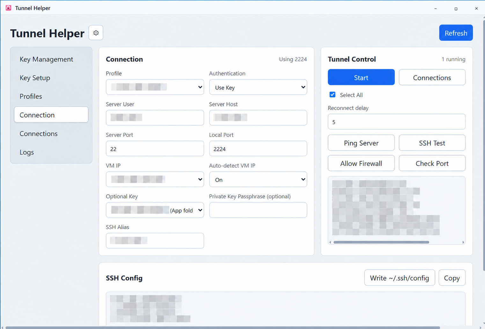
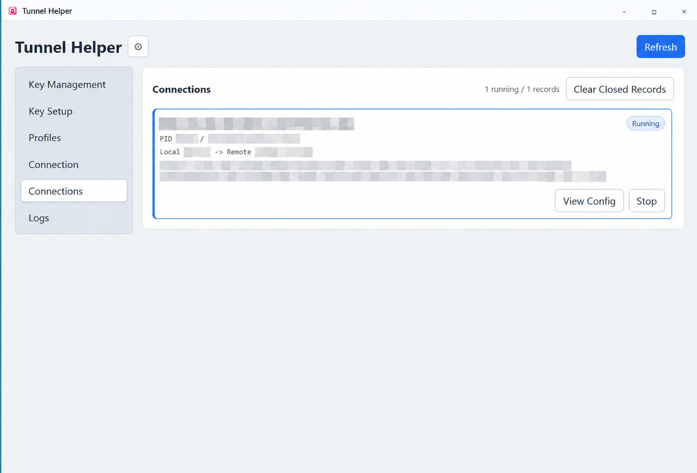

# Tunnel Helper

<p align="center">
  
</p>

Tunnel Helper provides a portable Windows desktop app and an experimental headless Linux web service for managing SSH tunnels, SSH keys, connection profiles, and OpenSSH config snippets.

它的目标是把零散的 SSH 命令、密钥文件和连接配置收进一个清晰的可视化流程里，降低重复操作和配置出错的概率。

## 界面预览

### 连接配置与隧道控制

<p align="center">
  
</p>

### 连接状态管理

<p align="center">
  
</p>

这个项目最初来自一个很具体的校园网络场景：学校内网访问需要通过腾讯 iOA/VPN 客户端完成。它可以让机器接入校园网络并访问学校服务器，但这类客户端对个人主力系统来说侵入性较强，可能修改系统设置、网络策略或安全配置，因此并不一定适合直接安装在本机。

一个更可控的做法是：准备一台 Windows 虚拟机，把 iOA/VPN 安装在虚拟机中，让虚拟机负责接入校园网络；然后在虚拟机里运行 Tunnel Helper，建立到学校服务器的 SSH 隧道，并放行虚拟机防火墙中的本地监听端口。这样，与该虚拟机处在同一局域网的主机或设备，就可以通过这个隧道访问学校服务器，同时把 iOA/VPN 与个人主力系统做物理和系统层面的隔离。

虽然项目背景来自 iOA/VPN 场景，但 Tunnel Helper 本身不是 iOA 专用工具。它更准确的定位是一个通用 SSH tunnel helper，适合需要用 SSH 本地端口转发访问远端服务、跳板机、虚拟机或内网机器的用户。

## 适用范围

Tunnel Helper 适合这些场景：

- VPN、iOA、零信任客户端运行在 Windows 虚拟机、跳板机或另一台 Windows 机器中。
- 希望把侵入性较强的网络客户端隔离在虚拟机里，不直接安装在主力系统。
- 需要通过 SSH 本地端口转发访问远端 Linux 服务器或内网服务。
- 需要让同一局域网内的其他机器通过虚拟机上的隧道端口访问目标服务器。
- 需要在多个连接档案之间切换，例如不同服务器、不同用户、不同本地端口。
- 希望可视化管理 SSH 私钥、公钥、`~/.ssh/config` 和连接状态。
- 希望把程序目录、密钥目录、配置文件一起复制到另一台机器继续使用。
- 需要生成新的 SSH 密钥，并把公钥安装到 Linux 服务器的 `authorized_keys`。

Tunnel Helper 不适合这些场景：

- 替代 iOA、VPN 或零信任客户端本身。
- 绕过学校、单位或服务器管理员明确禁止的访问策略。
- 管理复杂企业网络准入、路由策略或 VPN 拨号流程。
- 作为多人共享的密码保险库或密钥托管平台。

使用本工具前，请确认你的网络访问方式符合所在组织的安全、合规和授权要求。

## 主要功能

- 自动扫描程序相对目录和用户 `~/.ssh` 目录下的 SSH 密钥。
- 区分用户密钥和程序相对目录密钥。
- 批量导出、导入、删除密钥。
- 导出公钥 bundle，便于集中复制或安装公钥。
- 编辑和保存连接档案 `profiles.json`。
- 支持密钥认证和密码认证。
- 支持带私钥密码的密钥连接。
- 启动、停止和查看多个后台 SSH 隧道。
- Linux 无界面版本支持由动态地址服务器 B 主动连接固定地址服务器 A 的反向 SSH 隧道，并生成个人电脑使用的 `ProxyJump` 配置。
- Linux 浏览器界面提供服务关闭按钮、可选桌面托盘以及中英文帮助与填写示例。
- Linux 支持通过 `app_settings.json` 的 `server` 部分调整监听范围、端口和可选的持久 Token。
- 检测 SSH 服务连通性和本地端口占用；Windows 版可辅助放行防火墙。
- 写入或复制 OpenSSH `~/.ssh/config` 配置。
- 生成 SSH 密钥，并辅助安装公钥到 Linux 服务器。
- 支持中文和英文界面。

## Windows 便携目录

推荐把程序、密钥和配置放在同一个目录中，方便复制到虚拟机或其他 Windows 机器。

```text
Tunnel Helper/
  tunnel-helper.exe
  ssh_keyfiles_export/
    id_ed25519_example
    id_ed25519_example.pub
  profiles.json
  app_settings.json
```

其中：

- `tunnel-helper.exe` 是主程序。
- `ssh_keyfiles_export/` 用于保存程序相对目录密钥。
- `profiles.json` 保存连接档案。
- `app_settings.json` 保存界面语言、鼠标样式、默认填空行为等本地设置。

公开分享源码时，不要提交真实的 `ssh_keyfiles_export/`、`profiles.json` 或 `app_settings.json`。

## 基本使用流程

1. 在“密钥管理”中扫描或导入 SSH 密钥。
2. 在“密钥生成与安装”中生成新密钥，并把公钥安装到 Linux 服务器。
3. 在“配置管理”中创建或编辑连接档案。
4. 在“连接配置”中选择档案，检测 SSH 服务和本地端口。
5. 启动隧道后，在“Connections”中查看、停止或清理连接记录。
6. 在“Logs”中查看操作日志和命令反馈。

## SSH 配置

Tunnel Helper 可以生成 OpenSSH 配置片段，并写入用户目录下的：

```text
~/.ssh/config
```

这个配置可被 OpenSSH、VS Code Remote SSH、JetBrains Gateway 等工具读取。写入前请确认别名、端口、用户名和密钥路径正确。

## 安全提醒

不要提交这些本地文件到 GitHub：

- `ssh_keyfiles_export/`：可能包含私钥。
- `profiles.json`：可能包含服务器地址、用户名、密钥路径、密码字段。
- `app_settings.json`：可能包含本地默认填空信息和 Linux 服务访问 Token。
- `server_settings.json`：旧版 Linux 服务设置，可能包含访问 Token。
- `backups/`、`downloads/`、`node_modules/`、`src-tauri/target/`：构建产物或缓存目录。

仓库里只应该提供：

- `profiles.example.json`
- `app_settings.example.json`
- 源码、构建脚本、图标和必要资源

如果你要把项目公开到 GitHub，建议在提交前运行：

```powershell
git status --short
```

确认没有私钥、真实服务器配置或真实密码被加入提交。

## 开发

本项目使用 Tauri、Rust 和前端 Web 技术构建。Windows 原生编译需要 Microsoft C++ Build Tools。

安装依赖：

```powershell
npm install
```

启动开发模式：

```powershell
npm run dev
```

构建前端和 Tauri 程序：

```powershell
npm run build
```

生成便携版 exe：

```powershell
.\build-release.ps1
```

成功后，项目根目录会生成：

```text
tunnel-helper.exe
```

### Linux 无界面版本

Linux 服务端源码位于 `linux-server/`，与 Windows Tauri 后端独立编译，共用 `web/` 前端。它面向没有桌面环境的服务器：运行一个便携二进制，然后通过浏览器访问管理界面。发布的 Linux 便携版适用于 x86_64，程序静态链接并内置网页，但密钥和隧道功能仍需要系统提供 OpenSSH 客户端 `ssh`、`ssh-keygen`。

从 Release 下载 Linux 压缩包后解压并运行：

```bash
tar -xzf tunnel-helper-linux-x86_64.tar.gz
./tunnel-helper
```

其他同网段设备可通过 `http://<Linux主机IP>:6789` 访问；需要网络互通及防火墙允许。监听 `0.0.0.0` 包括所有 IPv4 网卡，不仅限于局域网。服务不会自动修改 Linux 防火墙。

从源码构建：

```bash
cd linux-server
sh build-portable.sh
mkdir portable
tar -xzf dist/tunnel-helper-linux-x86_64.tar.gz -C portable
./portable/tunnel-helper
```

默认监听 `0.0.0.0:6789`，Token 认证关闭，允许网络可达的设备访问。默认无认证时任何可访问者都能操作密钥和隧道，请使用可信网络和防火墙。HTTP 不加密，不应直接暴露到公网。

服务端把配置和密钥保存在 Linux 二进制同级的 `data/` 中。要启用持久 Token，在 `data/app_settings.json` 的 `server` 对象中设置 `tokenEnabled` 为 `true` 并重启；程序会生成并保存 `accessToken`。设置 `server.listen` 为 `127.0.0.1` 或使用 `--listen 127.0.0.1` 可限制为本机访问。旧版 `server_settings.json` 会在新配置尚无 `server` 字段时迁移，原文件保留。更多信息见 [linux-server/README.md](linux-server/README.md)。

反向隧道适用于目标主机不能被个人电脑直接访问，但能主动连接固定地址中转服务器的情况。程序在中转服务器回环地址上监听，个人电脑通过生成的 `ProxyJump` 配置访问目标主机。浏览器右上角的 `?` 中有正向和反向隧道的完整填写示例。

## 离线开发说明

项目曾按“尽量可离线迁移”的思路整理依赖：

- Rust、Node、构建缓存和安装包可以放在项目目录或上级 `downloads/` 目录。
- `node_modules/`、`src-tauri/target/` 不建议提交到 GitHub。
- 如果要在新机器上离线开发，需要提前准备对应平台的 Node、Rust、Cargo 缓存和 Windows 构建工具。

## License

This project is licensed under the MIT License. See [LICENSE](LICENSE) for details.
